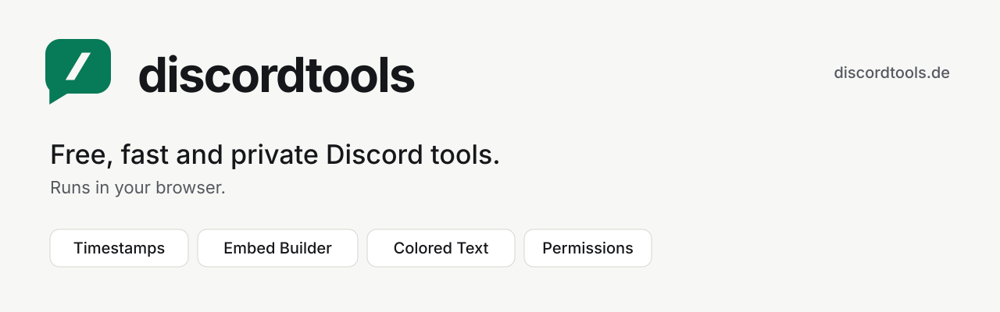
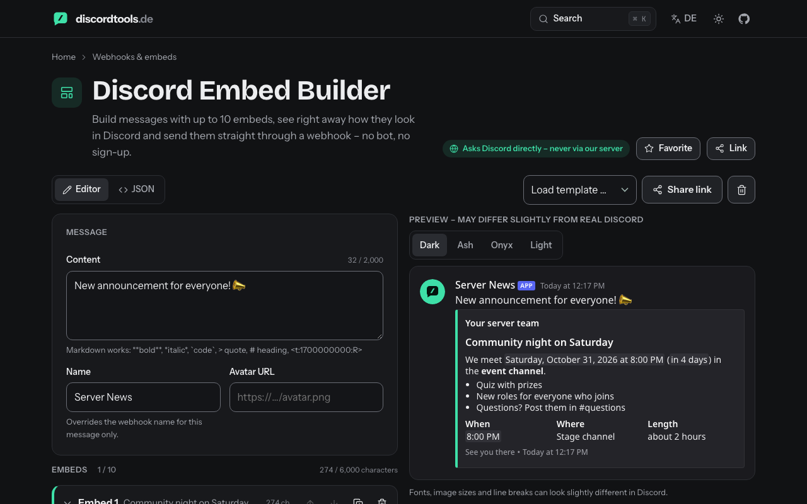
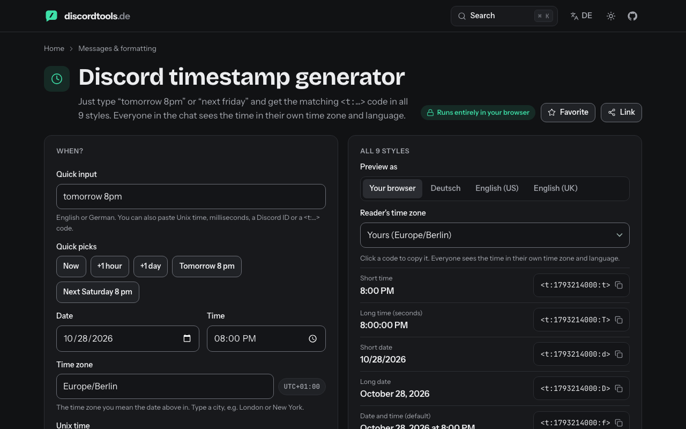
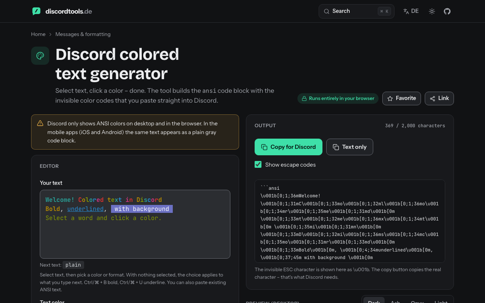
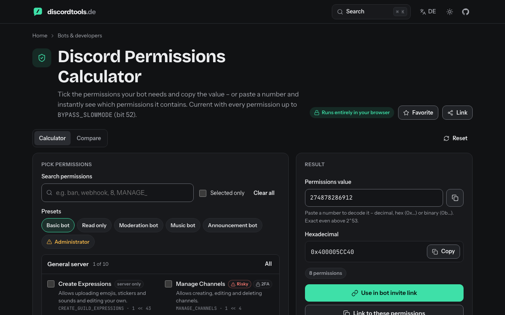
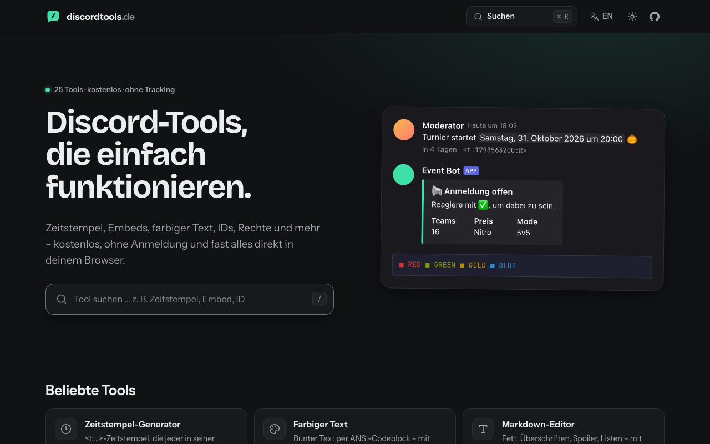

<p align="center">
  <a href="https://discordtools.de">
    <picture>
      <source media="(prefers-color-scheme: dark)" srcset="docs/banner-dark.svg">
      
    </picture>
  </a>
</p>

<p align="center">
  <a href="https://discordtools.de"><b>discordtools.de</b></a> ·
  <a href="https://discordtools.de/en">English</a> ·
  <a href="#tools">All tools</a> ·
  <a href="#privacy">Privacy</a> ·
  <a href="CONTRIBUTING.md">Contributing</a>
</p>

<p align="center">
  <a href="https://github.com/maximilianfeix/discordtools/actions/workflows/ci.yml"></a>
  
  
  
  <a href="LICENSE"></a>
</p>

**25 free Discord tools in one place** – timestamps, an embed builder with webhook sending, colored text, a permissions calculator that knows every permission up to bit 52, invite and widget lookups, server tags and more. No sign-up, no cookies, no tracking. Everything runs in your browser; when a tool needs Discord, your browser asks Discord directly.

🇩🇪 **Deutsch:** 25 kostenlose Discord-Tools – Zeitstempel, Embed-Builder, farbiger Text, Rechte-Rechner, Einladungs-Lookup und mehr. Ohne Anmeldung, ohne Tracking, komplett im Browser. → [discordtools.de](https://discordtools.de)

<p align="center">
  
</p>

## Why another Discord tools site?

- **Current.** All 9 timestamp styles (including the new `s` and `S`), every permission up to `BYPASS_SLOWMODE` (bit 52), today's markdown (headings, `-#` subtext, lists), the 2026 privileged-intent rules and Discord's four current themes in every preview.
- **Private by design.** There is no backend. Nothing you type is sent to us or stored; webhook URLs never leave your browser except to Discord itself and are never put into share links.
- **German and English.** Every tool, every explanation, every FAQ – including German natural-language input like „morgen 20 Uhr".
- **Built for phones.** Most Discord links get opened on a phone, so every tool is designed for 390 px first: big tap targets, an edit/preview switch, no zoom on focus.
- **Honest.** Previews say they are previews, approximate numbers are labelled, and things Discord doesn't document (invisible characters, ANSI on mobile) are marked as such.
- **No dodgy tools.** No token checkers, selfbots, mass senders or user lookups by bot token (Discord shut those down in 2025).

<h2 id="tools">Tools</h2>

**Messages & formatting**

| Tool | What it does | Links |
|---|---|---|
| Timestamp generator | <t:…> timestamps everyone sees in their own time zone. | [EN](https://discordtools.de/en/timestamp) · [DE](https://discordtools.de/zeitstempel) |
| Colored text | Colorful text via ANSI code blocks – with live preview. | [EN](https://discordtools.de/en/colored-text) · [DE](https://discordtools.de/farbiger-text) |
| Markdown editor | Bold, headings, spoilers, lists – with a real preview. | [EN](https://discordtools.de/en/markdown) · [DE](https://discordtools.de/markdown) |
| Mentions & syntax | Build syntax for users, roles, channels, commands and emojis. | [EN](https://discordtools.de/en/mentions) · [DE](https://discordtools.de/erwaehnungen) |
| Character counter | Will it fit? Limits for messages, bios, embeds and more. | [EN](https://discordtools.de/en/character-counter) · [DE](https://discordtools.de/zeichenzaehler) |

**Webhooks & embeds**

| Tool | What it does | Links |
|---|---|---|
| Embed builder | Build messages with embeds, preview live and send via webhook. | [EN](https://discordtools.de/en/embed-builder) · [DE](https://discordtools.de/embed-builder) |
| Webhook manager | Inspect, rename, change avatar or delete a webhook. | [EN](https://discordtools.de/en/webhook-manager) · [DE](https://discordtools.de/webhook-manager) |
| Embed colors | Hex ↔ decimal for embed colors, with palette and contrast check. | [EN](https://discordtools.de/en/embed-colors) · [DE](https://discordtools.de/embed-farben) |

**IDs & lookup**

| Tool | What it does | Links |
|---|---|---|
| Snowflake decoder | When was that account, server or message created? | [EN](https://discordtools.de/en/snowflake) · [DE](https://discordtools.de/snowflake) |
| Invite lookup | See the server behind an invite link without joining. | [EN](https://discordtools.de/en/invite-lookup) · [DE](https://discordtools.de/einladung-pruefen) |
| Server widget | Show online members and voice channels of a server. | [EN](https://discordtools.de/en/server-widget) · [DE](https://discordtools.de/server-widget) |
| Emoji & sticker downloader | Download custom emojis and stickers in full size. | [EN](https://discordtools.de/en/emoji-downloader) · [DE](https://discordtools.de/emoji-download) |

**Bots & developers**

| Tool | What it does | Links |
|---|---|---|
| Permissions calculator | Calculate and decode permission bitfields – always current. | [EN](https://discordtools.de/en/permissions-calculator) · [DE](https://discordtools.de/rechte-rechner) |
| Bot invite link | Build an OAuth2 link with scopes, permissions and install type. | [EN](https://discordtools.de/en/bot-invite-link) · [DE](https://discordtools.de/bot-einladen) |
| Intents calculator | Pick gateway intents and get the value. | [EN](https://discordtools.de/en/intents-calculator) · [DE](https://discordtools.de/intents-rechner) |
| Slash command builder | Design commands with options and export JSON. | [EN](https://discordtools.de/en/slash-command-builder) · [DE](https://discordtools.de/slash-command-builder) |
| Flags decoder | Decode user, message and channel flags. | [EN](https://discordtools.de/en/flags-decoder) · [DE](https://discordtools.de/flags-decoder) |
| Discord status | Is Discord down? Live status and current incidents. | [EN](https://discordtools.de/en/status) · [DE](https://discordtools.de/status) |

**Server setup**

| Tool | What it does | Links |
|---|---|---|
| Channel name generator | Pretty channel names with emojis, separators and fonts. | [EN](https://discordtools.de/en/channel-names) · [DE](https://discordtools.de/kanalnamen) |
| Role color preview | Test role colors and gradients in light and dark themes. | [EN](https://discordtools.de/en/role-colors) · [DE](https://discordtools.de/rollenfarben) |
| Rules generator | Server rules from building blocks – as text or embed. | [EN](https://discordtools.de/en/rules-generator) · [DE](https://discordtools.de/regeln) |

**Profile & fun**

| Tool | What it does | Links |
|---|---|---|
| Server tag generator | Ideas and preview for the 4-character server tags next to names. | [EN](https://discordtools.de/en/server-tag) · [DE](https://discordtools.de/server-tag) |
| Fancy text generator | 𝓕𝓪𝓷𝓬𝔂 fonts for names, bios and channels – copy and done. | [EN](https://discordtools.de/en/fancy-text) · [DE](https://discordtools.de/schriftarten) |
| Invisible character | Blank name, empty message or spacing – copy instantly. | [EN](https://discordtools.de/en/invisible-character) · [DE](https://discordtools.de/unsichtbares-zeichen) |
| Avatar tool | Crop your avatar and preview it with a status ring. | [EN](https://discordtools.de/en/avatar-tool) · [DE](https://discordtools.de/profilbild) |

<table>
  <tr>
    <td width="50%"></td>
    <td width="50%"></td>
  </tr>
  <tr>
    <td width="50%"></td>
    <td width="50%"></td>
  </tr>
</table>

<h2 id="privacy">Privacy</h2>

| What | Where it goes |
|---|---|
| Your input in local tools (timestamps, text, permissions, fonts, …) | Nowhere – computed in your browser |
| Invite lookup, server widget | Your browser → `discord.com` (public API, no token) |
| Embed builder sending, webhook manager | Your browser → `discord.com` with **your** webhook URL |
| Emoji/sticker downloads, previews | Your browser → `cdn.discordapp.com` / `media.discordapp.net` |
| Discord status | Your browser → `discordstatus.com` |
| Theme, favorites | `localStorage` on your device, only after you click |
| Analytics, cookies, third-party scripts, fonts from CDNs | None |

## Run it yourself

```bash
git clone https://github.com/maximilianfeix/discordtools
cd discordtools
npm install
npm run dev     # http://localhost:4321
npm test        # 250+ unit tests
npm run build   # static site in dist/ – host it anywhere
```

The build is plain static HTML/CSS/JS (Astro + Preact islands), so any static host works. The production setup (Caddy, security headers, CSP) is in [`deploy/`](deploy/).

### Project layout

```
src/tools/registry.ts      every tool: id, localized slug, icon, search keywords
src/components/tools/      one Preact island per tool (German + English strings)
src/components/discord/    Discord message/embed preview + markdown renderer
src/lib/                   pure logic (parsers, bitfields, limits) – covered by tests/
src/content/tools/         the explanation, steps and FAQ under each tool
```

## Contributing

Ideas, bug reports and translations are welcome – see [CONTRIBUTING.md](CONTRIBUTING.md). Please never paste tokens or webhook URLs into issues; see [SECURITY.md](SECURITY.md).

## License

[MIT](LICENSE). The name and logo are not covered by the license.

---

<sub>discordtools.de is an independent project and is not affiliated with, endorsed or sponsored by Discord Inc. “Discord” is a trademark of Discord Inc.</sub>
